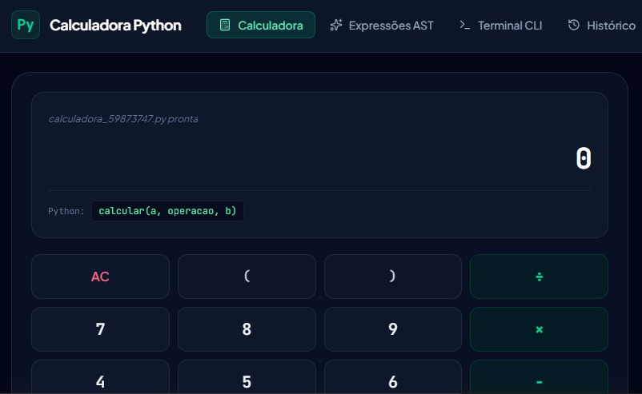

# 🧮 Calculadora Python & Web

Projeto de calculadora desenvolvido integrando um script robusto em Python com uma interface web moderna e interativa em **Dark Mode**.

---

## 🖼️ Demonstração Visual



---

## ⚡ Recursos e Funcionalidades

| Operação | Exemplo no Front-end | Função Python Equivalente |
| :--- | :--- | :--- |
| **➕ Adição** | `10 + 5 = 15` | `somar(10, 5)` |
| **➖ Subtração** | `20 - 8 = 12` | `subtrair(20, 8)` |
| **✖️ Multiplicação** | `6 × 4 = 24` | `multiplicar(6, 4)` |
| **➗ Divisão** | `20 ÷ 4 = 5` | `dividir(20, 4)` |
| **% Porcentagem** | `200 % 15 = 30` | `porcentagem(200, 15)` |

* **📜 Histórico Dinâmico:** Registro em tempo real de cada operação realizada durante a sessão web.
* **🛡️ Tratamento de Erros:** Prevenção contra divisões por zero e entradas numéricas inválidas.
* **💻 Atalhos de Teclado:** Suporte completo para digitação via teclado numérico no navegador.

---

## 🛠️ Tecnologias Utilizadas

- **Python 3:** Script de back-end com funções modulares, histórico acumulativo e suporte a avaliação de expressões.
- **HTML5:** Estruturação semântica da interface web.
- **CSS3:** Estilização personalizada em Dark Mode com CSS Grid e Flexbox.
- **JavaScript (ES6+):** Lógica de manipulação da DOM, tratamento de eventos do teclado e gestão de histórico.

---

## 📂 Estrutura de Arquivos

```text
📦 calculadora python
 ┣ 📂 web
 ┃  ┣ 📜 index.html
 ┃  ┣ 📜 script.js
 ┃  ┗ 📜 style.css
 ┣ 📜 calculadora.py
 ┣ 📜 preview.jpeg
 ┗ 📜 README.md